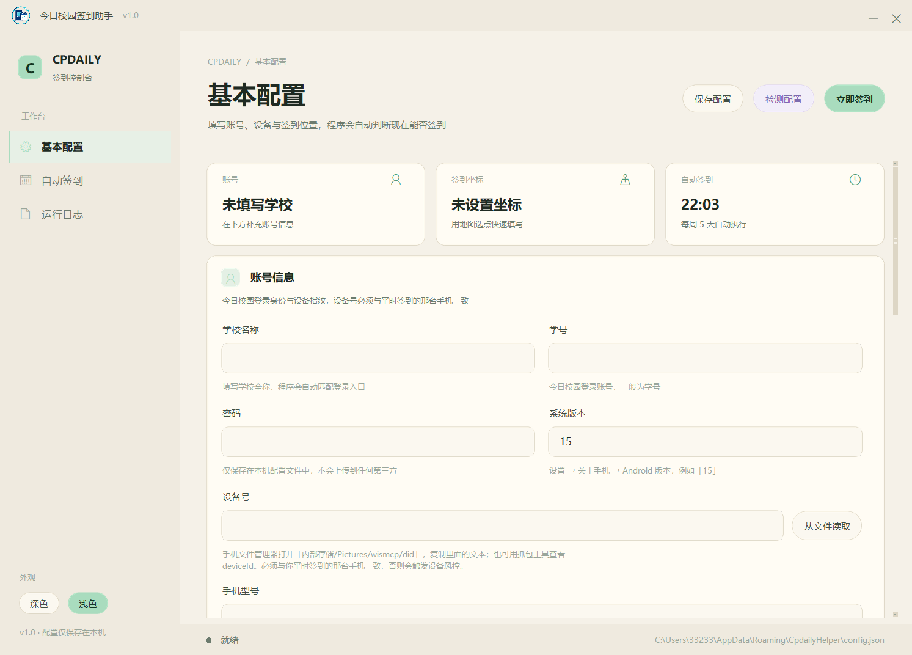
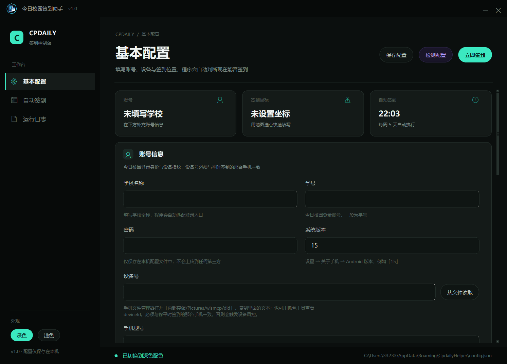

# 今日校园签到助手（CpdailyHelper）

Windows 桌面端的今日校园自动签到工具。tkinter 自绘界面，深/浅双主题，内置地图选点，可自定义星期方案并注册 Windows 计划任务定时执行。





## 功能

- 图形界面填写学校、学号、密码、设备号、手机型号、系统版本、签到地址、经纬度
- 自动解析学校登录入口 -> 登录 -> 查询未签到任务 -> 校验签到范围 -> 给出“能否签到”结论
- 一键立即签到（普通签到 / 查寝）
- 内置 Leaflet + 高德瓦片地图选点（GCJ-02 坐标）
- 自定义方案：每天 / 工作日 / 周一至周四 / 自定义星期，注册独立计划任务 `CpdailyHelperAutoSign`
- 深色（深空绿 + 荧光青）与浅色（米白 + 浅葱绿）双主题，点击即时切换并记忆偏好

## 环境要求

- Windows 10 / 11 x64
- Python 3.12（源码运行）
- Java 11+（登录组件依赖，可填 `JAVA_HOME` 或指定 `java.exe` 路径）

## 源码运行

```powershell
pip install requests pycryptodome pyDes pywebview pillow
# 先将 login-api.jar 放入 resources/，见下节
python app.py
```

## 构建 exe

```powershell
python -m PyInstaller CpdailyHelper.spec --noconfirm --clean
```

产物为 `dist/CpdailyHelper.exe`。

## 关于 login-api.jar（重要）

本仓库**不包含** `login-api.jar`。它是第三方开源项目 [wisedu-unified-login-api](https://github.com/ZimoLoveShuang/wisedu-unified-login-api) 的构建产物，版权归原作者，文件约 57 MB。

请自行从该仓库的 Releases 下载，重命名为 `login-api.jar` 放入 `resources/` 目录后再运行或构建。本程序仅通过本地 HTTP 接口调用它完成统一身份认证，不修改其内容。

## 与 auto-sign 的关系

登录与签到的协议细节参考了 [zimo0o0omiz/auto-sign](https://github.com/zimo0o0omiz/auto-sign)（该仓库已归档）。本仓库是该脚本的独立图形化实现，**不包含**原项目任何代码文件。

## 隐私

- 所有配置仅写入 `%APPDATA%\CpdailyHelper\config.json`，不会上传到任何第三方服务器
- 仓库与发布产物中不含任何真实账号、学校或位置信息

## 免责声明

仅供个人学习与自用。请遵守所在学校的规定，禁止将本项目用于付费代挂服务。使用本项目产生的任何后果由使用者自行承担。

## 致谢

- [zimo0o0omiz/auto-sign](https://github.com/zimo0o0omiz/auto-sign) — 签到协议与思路来源
- [ZimoLoveShuang/wisedu-unified-login-api](https://github.com/ZimoLoveShuang/wisedu-unified-login-api) — 统一身份认证组件
- [Leaflet](https://leafletjs.com/) 与高德地图瓦片 — 地图选点

## License

MIT，仅覆盖本仓库自有代码。第三方组件遵循其各自协议。
